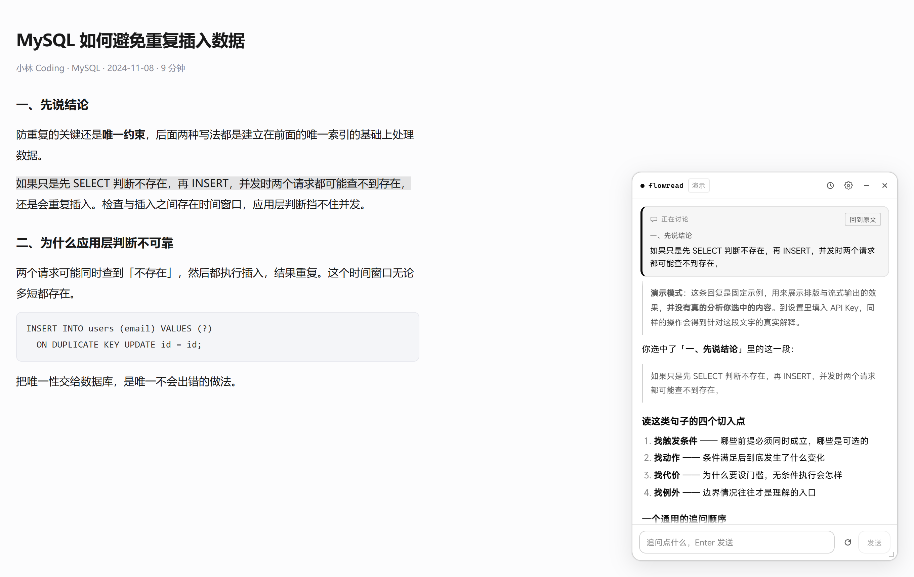
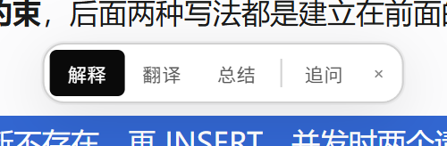
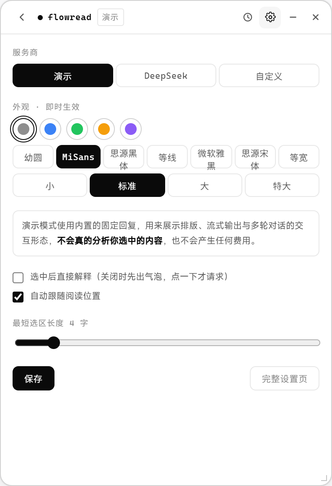

# FlowRead

> 一个贴在网页上的阅读助手：划词即问，答案就在旁边，不打断你正在读的东西。



## 它是什么

读技术文章时，遇到看不懂的段落，通常要在「选中 → 复制 → 切到 ChatGPT → 粘贴 → 说明上下文」之间来回折腾。FlowRead 把这套动作压成一次划词。

选中文字，旁边会出现一排小按钮：



点「解释」就得到针对**这一段**的回答，并且会**记住你问的是哪一段** —— 后面继续追问，它始终围绕这段展开，滚动页面也不会跑偏。

## 它不是什么

- **不是通用聊天机器人**。它只讨论你选中的那段文字，上下文是锁定的。
- **不是商业产品**。没有账号体系、没有服务端、没有同步。你的 Key、你的对话，全都只在这台机器上。
- **不是全自动的**。默认不往任何页面里塞 UI，只有你划词或主动唤出时它才出现。

## 特性

**划词动作**

- 解释 / 翻译 / 总结，一键出结果
- 追问：把讨论对象换成新段落，光标直接落进输入框，你自己组织问题

**上下文锁定**

- 会话绑定在「你选中的那段原文」上，滚动、翻页、切标签都不会改变它
- 页面上的原文会一直高亮，随时知道在讨论什么
- 读到别的章节时，卡片上会出现「换成当前段落」

**长对话不会失忆**

历史越长，发送给模型的内容长度基本不变：

- 锚点原文：**永久保留**，不参与压缩
- 早期对话：压成约 200 字滚动摘要（累进压缩，不是每次重压）
- 最近 6 轮：保留完整原文，细节不失真

压缩发生后，卡片下方会明确告诉你「前 N 条已压缩」。

**能查整篇文章（Agent）**

上下文锁定在选中的那段，但不代表它只看得到那一段。接真实模型时，它会按需调用三个工具：

| 工具 | 什么时候用 |
|---|---|
| `get_article_outline` | "这篇文章讲什么""有哪些章节" |
| `search_article` | "别的地方提过这个概念吗""第五节说的 XX 是什么" |
| `read_section` | 需要整节内容详细对比时 |

模型自己决定要不要查、查什么，不用你指定。执行时浮窗上会显示「正在全文搜索「扩容」」，不会让你干等。

这一步是它从"段落解释器"变成"阅读助手"的分界线。演示模式不会调用工具（没有真实模型）。

**外观可调**

- 7 种字体（MiSans / 幼圆 / 思源黑体 / 等线 / 微软雅黑 / 思源宋体 / 等宽）
- 5 种强调色，4 档字号
- 改动即时生效，不用保存、不用刷新

**窗口行为**

- 八方向缩放（四边 + 四角）
- 拖到屏幕边缘自动吸附
- 布局与站点偏好持久化：你在某个站点关掉它，下次进来就不会自己冒出来



## 安装

暂时没有上架商店，用开发者模式加载：

```bash
git clone <this-repo> flowread
cd flowread
npm install
npm run build
```

然后：

1. 打开 `chrome://extensions`
2. 右上角打开 **开发者模式**
3. 点 **加载已解压的扩展程序**，选择 `flowread/.output/chrome-mv3`

> Chrome 137 起官方移除了 `--load-extension` 命令行参数，所以这一步只能手动操作。

## 配置模型

扩展默认使用**内置演示模式**，不填 Key 也能完整体验交互（回复是固定示例，会明确标注，不会假装分析了你的文章）。

要用真实模型：

1. 点插件图标 → 打开设置
2. 服务商选 DeepSeek（或自定义 OpenAI 兼容接口）
3. 填 API Key，点「保存」→「测试连接」

DeepSeek 用的是静态声明的域名权限；自定义地址会在保存时按需申请，不需要额外授权。

**Key 存在哪**：`chrome.storage.local`，属于扩展自己的存储，网页脚本读不到。但**是明文，没有加密** —— 能和本机浏览器数据打交道的人也能读走它。共用电脑上不建议存长期 Key。

## 支持的模型

任何 OpenAI 兼容的 `/chat/completions` 接口都能用：

- DeepSeek（默认，`https://api.deepseek.com`）
- OpenAI（`https://api.openai.com/v1`）
- Moonshot / SiliconFlow / 自建网关等

## 隐私

- 没有服务端，没有账号，没有遥测
- 对话记录存在扩展自己的 IndexedDB 里，不随网页清理消失，也不会跨设备同步
- 只有你主动提问时，才会把你的问题和选中原文发给模型服务商

## 已知限制

- **只在 Chromium 系浏览器上测过**（依赖 CSS Custom Highlight API，Chrome 105+）
- **iframe 内、PDF 阅读器内划词无效**，浏览器的 Selection 拿不到跨文档选区
- **中文长对话的摘要质量依赖模型**，压缩后细节会损失，但原始消息完整保留在历史里
- **不支持数学公式渲染**，模型若输出 LaTeX 会显示成纯文本

## 开发

```bash
npm run dev      # 开发模式，热更新（加载 .output/chrome-mv3-dev）
npm run build    # 生产构建
npm run verify   # 类型检查 + 单测 + 构建 + 浏览器验收
npm run e2e:buttons  # 单独跑划词按钮的行为矩阵
npm run zip      # 打包成可分发 zip
```

`npm run verify` 会启动真实 Chromium 加载扩展，跑 26 项端到端验收。

技术栈：WXT + Vue 3 + TypeScript，无 UI 框架，样式手写 CSS。

### 结构

```
entrypoints/     background SW / content script / options / popup
components/      浮窗、气泡、消息、设置、历史
composables/     选区、拖拽缩放、阅读位置、聊天状态、外观、高亮
background/      IndexedDB、设置、上下文引擎、模型 provider、滚动摘要
shared/          Markdown 渲染、token 估算、常量
utils/           几何计算、锚点定位、DOM 上下文提取
```

## License

MIT
